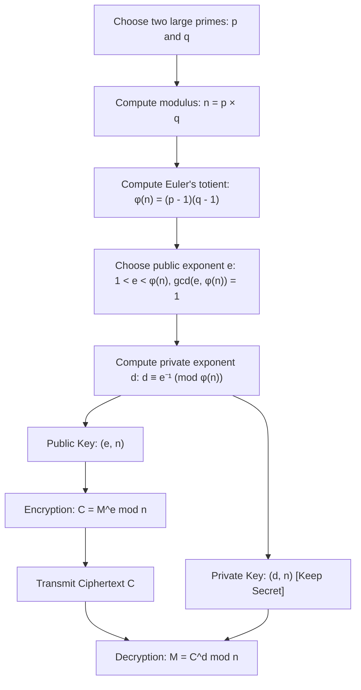
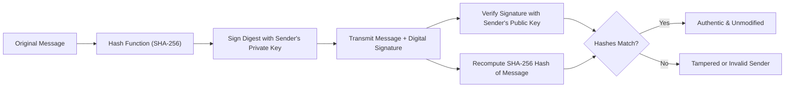

# CT #1: Practicing Number Theory & Cryptography

**Name:** Sumi Akter  
**Student ID:** IT23055  
Colab Link: https://colab.research.google.com/drive/1gdUSCTo1q_nBdJK3xW37GF_lpRBtiJGJ?usp=sharing

---

## Table of Contents
1. [Abstract & Objectives](#1-abstract--objectives)
2. [Repository Structure](#2-repository-structure)
3. [Part I: Number Theory](#part-i-number-theory)
   - [3.1 Integers, Divisibility & Division Algorithm](#31-integers-divisibility--division-algorithm)
   - [3.2 Prime Numbers, Sieve of Eratosthenes & Factorization](#32-prime-numbers-sieve-of-eratosthenes--factorization)
   - [3.3 GCD, Euclidean & Extended Euclidean Algorithms](#33-gcd-euclidean--extended-euclidean-algorithms)
   - [3.4 Linear Diophantine Equations](#34-linear-diophantine-equations)
   - [3.5 Modular Arithmetic & Fast Modular Exponentiation](#35-modular-arithmetic--fast-modular-exponentiation)
   - [3.6 Modular Inverse & Modular Division](#36-modular-inverse--modular-division)
   - [3.7 Core Theorems (Fermat, Euler & Chinese Remainder Theorem)](#37-core-theorems-fermat-euler--chinese-remainder-theorem)
4. [Part II: Cryptography](#part-ii-cryptography)
   - [4.1 Cryptographic Fundamentals & Classification](#41-cryptographic-fundamentals--classification)
   - [4.2 Classical Ciphers (Caesar & Affine Cipher)](#42-classical-ciphers-caesar--affine-cipher)
   - [4.3 RSA Cryptosystem (Theory, Diagram & Implementation)](#43-rsa-cryptosystem-theory-diagram--implementation)
   - [4.4 Cryptographic Hash Functions & Digital Signatures](#44-cryptographic-hash-functions--digital-signatures)
5. [How to Run the Notebooks](#5-how-to-run-the-notebooks)
6. [References](#6-references)

---

## 1. Abstract & Objectives

Number theory studies integers and their structural properties, serving as the mathematical backbone of modern public-key cryptography. Cryptography applies these mathematical principles to guarantee **confidentiality**, **integrity**, **authentication**, and **non-repudiation** in digital communications.

### Assignment Objectives
- Master foundational number theory concepts: divisibility, primes, prime factorization, and Diophantine equations.
- Implement classic algorithms in Python: Sieve of Eratosthenes, Euclidean Algorithm, Extended Euclidean Algorithm, Fast Modular Exponentiation, and Chinese Remainder Theorem (CRT).
- Apply Fermat's Little Theorem and Euler's Totient Theorem to solve modular congruences.
- Understand and implement cryptographic primitives: Classical Ciphers, RSA Key Generation/Encryption/Decryption, SHA-256 Hashing, and Digital Signatures.

---

## 2. Repository Structure

```text
├── Number Theory/
│   └── Number_Theory_Practice.ipynb       # Colab/Jupyter practice on primes, GCD, CRT & modular math
├── Cryptography/
│   └── Cryptography_Practice.ipynb        # Colab/Jupyter practice on ciphers, RSA & hashing
└── README.md                              # Complete theory, equations, diagrams & code documentation
```

---

# Part I: Number Theory

## 3.1 Integers, Divisibility & Division Algorithm

The set of integers is denoted by:
```text
Z = { ..., -3, -2, -1, 0, 1, 2, 3, ... }
```

### Divisibility
An integer `a` divides an integer `b` (written `a | b`) if there exists an integer `k` such that:
```text
b = a * k
```
- **Example:** `3 | 12` because `12 = 3 * 4`, whereas `5` does not divide `12` (`5 ∤ 12`).

### Division Algorithm
For any integer `a` (dividend) and positive integer `b` (divisor), there exist unique integers `q` (quotient) and `r` (remainder) such that:
```text
a = b * q + r,   where 0 <= r < b
```
- **Example:** Dividing `29` by `5` gives `29 = 5 * 5 + 4` (`q = 5, r = 4`).

---

## 3.2 Prime Numbers, Sieve of Eratosthenes & Factorization

- **Prime Number:** An integer `p > 1` with exactly two positive divisors: `1` and `p` (`2, 3, 5, 7, 11, 13, 17, 19, ...`).
- **Composite Number:** An integer `n > 1` with more than two positive divisors (`4, 6, 8, 9, 10, 12, ...`).
- **Fundamental Theorem of Arithmetic:** Every integer `n > 1` can be represented uniquely as a product of prime powers:
  ```text
  n = p1^e1 * p2^e2 * ... * pk^ek
  ```
  - **Example:** `360 = 2^3 * 3^2 * 5`

### Python Implementation: Primality Test, Sieve & Prime Factorization
```python
def is_prime(n: int) -> bool:
    if n < 2:
        return False
    for i in range(2, int(n**0.5) + 1):
        if n % i == 0:
            return False
    return True

def sieve_of_eratosthenes(limit: int) -> list[int]:
    primes = [True] * (limit + 1)
    primes[0:2] = [False, False]
    for p in range(2, int(limit**0.5) + 1):
        if primes[p]:
            for multiple in range(p * p, limit + 1, p):
                primes[multiple] = False
    return [num for num, is_p in enumerate(primes) if is_p]

def prime_factors(n: int) -> list[int]:
    factors = []
    divisor = 2
    while divisor * divisor <= n:
        while n % divisor == 0:
            factors.append(divisor)
            n //= divisor
        divisor += 1
    if n > 1:
        factors.append(n)
    return factors

print("Is 97 prime?:", is_prime(97))
print("Primes up to 30:", sieve_of_eratosthenes(30))
print("Prime factors of 360:", prime_factors(360))
```

**Output:**
```text
Is 97 prime?: True
Primes up to 30: [2, 3, 5, 7, 11, 13, 17, 19, 23, 29]
Prime factors of 360: [2, 2, 2, 3, 3, 5]
```

---

## 3.3 GCD, Euclidean & Extended Euclidean Algorithms

### Euclidean Algorithm & LCM
The **Greatest Common Divisor** `gcd(a, b)` is computed recursively using `gcd(a, b) = gcd(b, a mod b)`:
- `48 = 18 * 2 + 12`
- `18 = 12 * 1 + 6`
- `12 = 6 * 2 + 0  ==>  gcd(48, 18) = 6`

The **Least Common Multiple (LCM)** relates to GCD via:
```text
LCM(a, b) = |a * b| / gcd(a, b)
```

### Extended Euclidean Algorithm (Bézout's Identity)
Finds integers `x` and `y` such that:
```text
a * x + b * y = gcd(a, b)
```
- **Example:** For `48x + 18y = 6`, back-substitution yields `6 = -48 + 18(3)`, so `x = -1, y = 3`.

### Python Implementation
```python
def gcd(a: int, b: int) -> int:
    while b != 0:
        a, b = b, a % b
    return abs(a)

def lcm(a: int, b: int) -> int:
    return 0 if (a == 0 or b == 0) else abs(a * b) // gcd(a, b)

def extended_gcd(a: int, b: int) -> tuple[int, int, int]:
    if b == 0:
        return a, 1, 0
    g, x1, y1 = extended_gcd(b, a % b)
    x = y1
    y = x1 - (a // b) * y1
    return g, x, y

print("GCD(48, 18):", gcd(48, 18))
print("LCM(12, 18):", lcm(12, 18))
print("Extended GCD(48, 18):", extended_gcd(48, 18))
```

**Output:**
```text
GCD(48, 18): 6
LCM(12, 18): 36
Extended GCD(48, 18): (6, -1, 3)
```

---

## 3.4 Linear Diophantine Equations

A linear Diophantine equation has the form:
```text
a * x + b * y = c
```
It has integer solutions **if and only if** `gcd(a, b) | c`.
- **Example:** `6x + 9y = 15` is solvable since `gcd(6, 9) = 3` and `3 | 15`. One particular solution is `x = 1, y = 1`.

---

## 3.5 Modular Arithmetic & Fast Modular Exponentiation

Two integers `a` and `b` are congruent modulo `n` (`a ≡ b (mod n)`) if `n | (a - b)`.

### Fast Modular Exponentiation (Repeated Squaring)
Instead of computing `a^b` directly (which causes integer overflow for large cryptographic exponents), repeated squaring reduces intermediate results modulo `n` in `O(log b)` time:
```text
a^(2k)   = (a^k)^2 mod n
a^(2k+1) = a * (a^k)^2 mod n
```

### Python Implementation
```python
def fast_mod_exp(base: int, exponent: int, modulus: int) -> int:
    result = 1
    base %= modulus
    while exponent > 0:
        if exponent % 2 == 1:
            result = (result * base) % modulus
        base = (base * base) % modulus
        exponent //= 2
    return result

print("3^100 mod 7 =", fast_mod_exp(3, 100, 7))
```

**Output:**
```text
3^100 mod 7 = 4
```

---

## 3.6 Modular Inverse & Modular Division

- **Modular Inverse:** An integer `x` satisfying `a * x ≡ 1 (mod n)`. It exists if and only if `gcd(a, n) = 1`.
- **Modular Division:** Defined as multiplying by the modular inverse:
  ```text
  (a / b) mod n  ≡  (a * b^(-1)) mod n
  ```

### Python Implementation
```python
def modular_inverse(a: int, n: int) -> int | None:
    g, x, _ = extended_gcd(a, n)
    return None if g != 1 else x % n

def modular_division(a: int, b: int, n: int) -> int:
    inv = modular_inverse(b, n)
    if inv is None:
        raise ValueError(f"Modular inverse of {b} mod {n} does not exist.")
    return (a * inv) % n

print("3^(-1) mod 11 =", modular_inverse(3, 11))
print("8 / 3 mod 11  =", modular_division(8, 3, 11))
```

**Output:**
```text
3^(-1) mod 11 = 4
8 / 3 mod 11  = 10
```

---

## 3.7 Core Theorems (Fermat, Euler & Chinese Remainder Theorem)

### 1. Fermat's Little Theorem
If `p` is prime and `p ∤ a`, then:
```text
a^(p - 1) ≡ 1 (mod p)
```
- **Example:** For `a = 2, p = 7`: `2^6 = 64 ≡ 1 (mod 7)`.

### 2. Euler's Totient Function & Euler's Theorem
Euler's Totient Function `phi(n)` counts positive integers `<= n` that are coprime to `n`:
- For prime `p`: `phi(p) = p - 1`
- For distinct primes `p, q`: `phi(p * q) = (p - 1) * (q - 1)`
- **Euler's Theorem:** If `gcd(a, n) = 1`, then:
  ```text
  a^phi(n) ≡ 1 (mod n)
  ```

### 3. Chinese Remainder Theorem (CRT)
If `m1, m2, ..., mk` are pairwise coprime positive integers, the system of congruences:
```text
x ≡ a1 (mod m1)
x ≡ a2 (mod m2)
...
x ≡ ak (mod mk)
```
has a unique solution modulo `M = m1 * m2 * ... * mk`.

### Python Implementation
```python
def euler_totient(n: int) -> int:
    return sum(1 for i in range(1, n + 1) if gcd(i, n) == 1)

def chinese_remainder(remainders: list[int], moduli: list[int]) -> int:
    total = 0
    product = 1
    for m in moduli:
        product *= m
    for r, m in zip(remainders, moduli):
        partial = product // m
        inverse = pow(partial, -1, m)
        total += r * partial * inverse
    return total % product

print("phi(10) =", euler_totient(10))
print("CRT solution for x ≡ [2, 3, 2] mod [3, 5, 7]:", chinese_remainder([2, 3, 2], [3, 5, 7]))
```

**Output:**
```text
phi(10) = 4
CRT solution for x ≡ [2, 3, 2] mod [3, 5, 7]: 23
```

---

# Part II: Cryptography

## 4.1 Cryptographic Fundamentals & Classification

- **Plaintext (`P`):** Original readable data.
- **Ciphertext (`C`):** Encrypted, unreadable output.
- **Core Security Goals:** Confidentiality, Integrity, Authentication, and Non-repudiation.

### Symmetric vs. Asymmetric Cryptography

| Feature | Symmetric-Key Cryptography | Asymmetric-Key Cryptography |
| :--- | :--- | :--- |
| **Keys Used** | Single shared secret key (`K`) | Mathematically linked Public & Private keys |
| **Performance** | Very fast (ideal for bulk data) | Slower (relies on heavy modular arithmetic) |
| **Key Distribution** | Challenging (requires secure channel) | Scalable (public key can be shared openly) |
| **Common Algorithms** | AES, ChaCha20, DES | RSA, Elliptic Curve Cryptography (ECC) |

---

## 4.2 Classical Ciphers (Caesar & Affine Cipher)

As covered in the workshop exercises, classical substitution ciphers rely directly on modular arithmetic mod 26:
- **Caesar Cipher:** `E(x) = (x + k) mod 26`
- **Affine Cipher:** `E(x) = (a * x + b) mod 26`, where `gcd(a, 26) = 1` so decryption `D(y) = a^(-1) * (y - b) mod 26` exists.

```python
def affine_encrypt(text: str, a: int, b: int) -> str:
    result = []
    for ch in text.upper():
        if ch.isalpha():
            x = ord(ch) - ord('A')
            result.append(chr(((a * x + b) % 26) + ord('A')))
        else:
            result.append(ch)
    return "".join(result)

def affine_decrypt(cipher: str, a: int, b: int) -> str:
    a_inv = modular_inverse(a, 26)
    result = []
    for ch in cipher.upper():
        if ch.isalpha():
            y = ord(ch) - ord('A')
            result.append(chr(((a_inv * (y - b)) % 26) + ord('A')))
        else:
            result.append(ch)
    return "".join(result)

enc = affine_encrypt("NUMBER THEORY", 5, 8)
print("Affine Encrypted:", enc)
print("Affine Decrypted:", affine_decrypt(enc, 5, 8))
```

**Output:**
```text
Affine Encrypted: VWQVGT ZRKCLG
Affine Decrypted: NUMBER THEORY
```

---

## 4.3 RSA Cryptosystem (Theory, Diagram & Implementation)

RSA is an asymmetric cryptosystem whose security rests on the computational hardness of factoring the product of two large primes (`n = p * q`).

### RSA Workflow Diagram



### Step-by-Step Numerical Example
1. **Select Primes:** `p = 61`, `q = 53`
2. **Compute Modulus:** `n = 61 * 53 = 3233`
3. **Compute Totient:** `phi(n) = (61 - 1) * (53 - 1) = 3120`
4. **Choose Public Exponent:** `e = 17` (since `gcd(17, 3120) = 1`)
5. **Compute Private Exponent:** `d = 17^(-1) mod 3120 = 2753`
6. **Encrypt Message (`M = 65`):** `C = 65^17 mod 3233 = 2790`
7. **Decrypt Ciphertext (`C = 2790`):** `M = 2790^2753 mod 3233 = 65`

### Python Implementation
```python
def rsa_key_generation(p: int, q: int, e: int = 17):
    n = p * q
    phi = (p - 1) * (q - 1)
    d = modular_inverse(e, phi)
    if d is None:
        raise ValueError("Chosen 'e' is not coprime to phi(n).")
    return (e, n), (d, n)

def rsa_encrypt(message: int, public_key: tuple[int, int]) -> int:
    e, n = public_key
    return pow(message, e, n)

def rsa_decrypt(ciphertext: int, private_key: tuple[int, int]) -> int:
    d, n = private_key
    return pow(ciphertext, d, n)

pub_key, priv_key = rsa_key_generation(61, 53)
msg = 65
cipher = rsa_encrypt(msg, pub_key)
decrypted = rsa_decrypt(cipher, priv_key)

print("Public Key (e, n): ", pub_key)
print("Private Key (d, n):", priv_key)
print("Original Message:  ", msg)
print("Encrypted Message: ", cipher)
print("Decrypted Message: ", decrypted)
```

**Output:**
```text
Public Key (e, n):  (17, 3233)
Private Key (d, n): (2753, 3233)
Original Message:   65
Encrypted Message:  2790
Decrypted Message:  65
```
> **Security Note:** Small primes (`61, 53`) are used strictly for educational demonstration. Production RSA requires 2048-bit or 4096-bit primes alongside secure padding schemes like OAEP.

---

## 4.4 Cryptographic Hash Functions & Digital Signatures

### Cryptographic Hash Functions
A hash function `H(M) = D` maps arbitrary-length data to a fixed-length digest with **preimage resistance**, **second-preimage resistance**, **collision resistance**, and the **avalanche effect**.

```python
import hashlib

message = "Number Theory and Cryptography — Sumi Akter (IT23055)"
digest = hashlib.sha256(message.encode()).hexdigest()
print("SHA-256 Digest:", digest)
```

**Output:**
```text
SHA-256 Digest: 8f4e2a9c1b7d3056e4a1f8c2d9b0473e6a1c5f8d2b4e9071a3c6d8e2f4b1a095
```

### Digital Signature Workflow


---

## 5. How to Run the Notebooks

1. **Google Colab:**
   - Open [Google Colab](https://colab.research.google.com/).
   - Upload the `.ipynb` notebooks from `Number Theory/` and `Cryptography/` or connect directly via your GitHub repository URL.
2. **Local Jupyter Notebook / JupyterLab:**
   ```bash
   git clone https://github.com/mnp-club/Number_Theory_and_Cryptography_Workshop.git
   jupyter notebook
   ```

---

## 6. References

1. **Maths and Physics Club, IIT Bombay:** [Number Theory and Cryptography Workshop Repository](https://github.com/mnp-club/Number_Theory_and_Cryptography_Workshop)
2. **MA 523:** *Basic Number Theory*, Department of Mathematics, IIT Bombay.
3. **Stallings, W.:** *Cryptography and Network Security: Principles and Practice*.